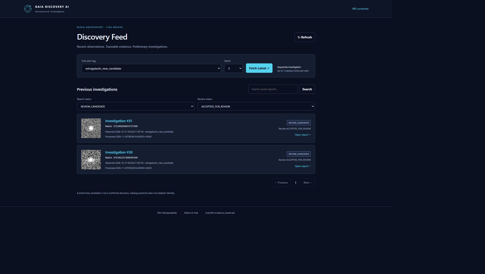
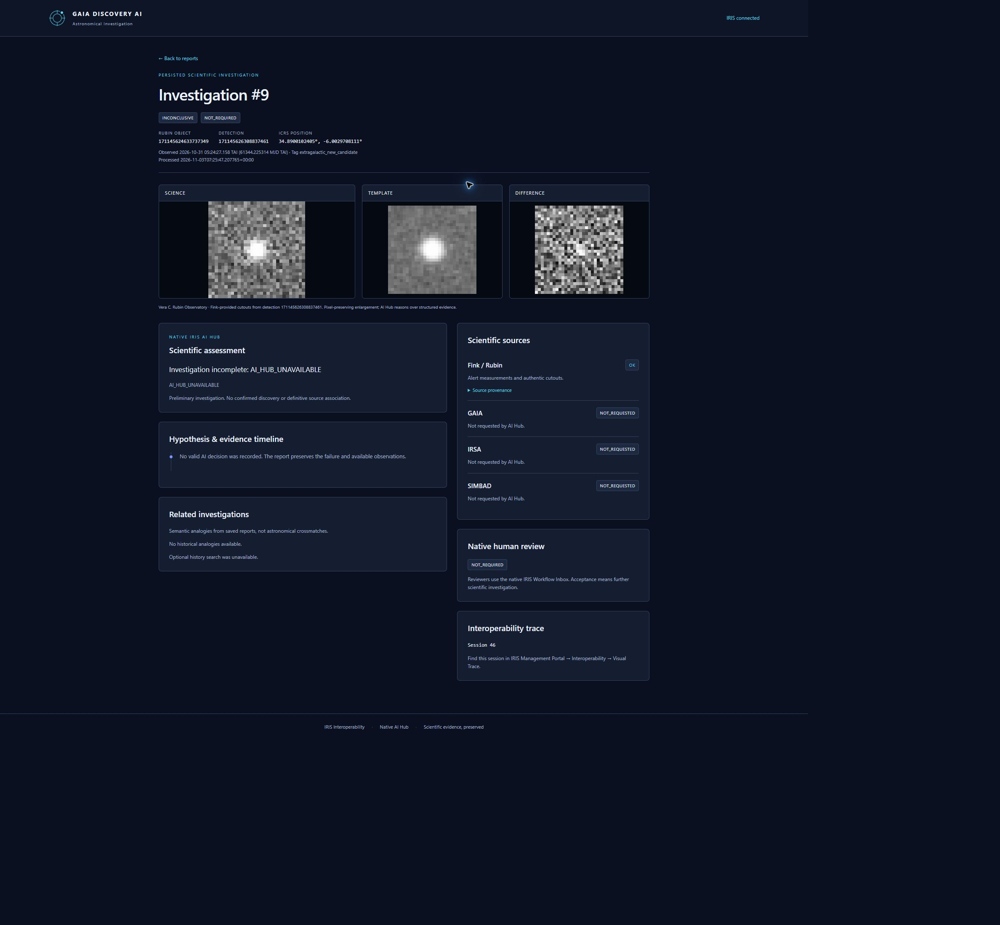
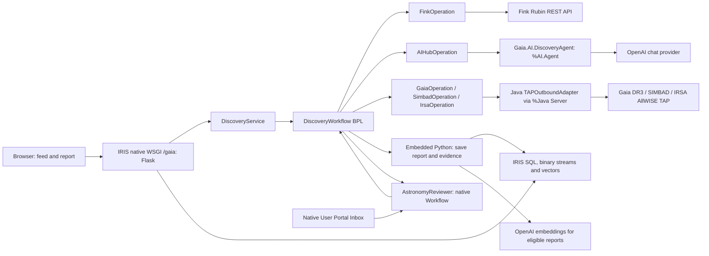
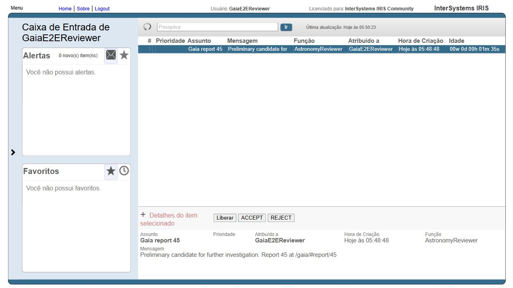

# Gaia Discovery AI

**Traceable preliminary investigations of Rubin/Fink astronomical alerts inside InterSystems IRIS.**

## From an alert to an investigation

Time-domain astronomy studies how the sky changes between observations. An alert is a detection that merits investigation; interpreting it requires measurements, images and astronomical context. An alert broker connects survey alerts with scientists: [Fink](https://doc.lsst.fink-broker.org/) stores alerts, enriches them with catalog information and classifications, and distributes selected events for analysis and follow-up.

Astronomers and scientific reviewers must assemble that evidence without confusing a nearby catalog source with the detected object. Catalogs and observations use different epochs, positional uncertainties and image resolutions. An empty search means no row within a particular query; an unavailable catalog means the search was not evaluated. Treating either as proof of novelty can misdirect follow-up effort. Integration operators also need to separate scientific uncertainty from technical failures.

Gaia Discovery AI retrieves a bounded batch of Rubin alerts from Fink, preserves the latest detection and its images, and asks a native IRIS AI Hub agent which catalog question to investigate next. A Business Process Language (BPL) workflow validates that decision and executes the selected query. It saves reasoning, source responses, provenance and the interoperability session with each report. Preliminary candidates enter the native IRIS Workflow Inbox for human review.

**A candidate, nearby catalog source, semantic analogy or reviewer's ACCEPT action does not confirm an astronomical discovery.**

| Term | Meaning in this application |
|---|---|
| Object / detection | `diaObjectId` identifies a Fink object; `diaSourceId` identifies a detection. Both remain strings to preserve large identifiers. |
| Science / template / difference | Observation, reference and difference image cutouts retrieved from Fink for the selected detection. |
| ICRS / RA / Dec | Celestial reference system and right ascension/declination coordinates, stored in degrees. |
| MJD TAI | Modified Julian Date using International Atomic Time; observation time is separate from processing time. |
| TAP / ADQL | Table Access Protocol and Astronomical Data Query Language, used for bounded positional catalog queries. |
| Cone search | Search inside an angular radius around a sky position; rows are candidate associations. |
| Semantic history | Similarity between saved report text vectors; analogy between investigations, not an astronomical crossmatch. |

## Capabilities and value

| Implemented capability | Practical value | Implementation |
|---|---|---|
| Async batches of 1–20 alerts, default 5 | Browser polls independently of investigation and human review. | `DiscoveryService.StartRun`, `^GaiaRuns`, Flask routes |
| Adaptive catalog selection | Each decision uses accumulated evidence; only selected catalogs execute. | BPL, `AIHubOperation`, `Gaia.AI.DiscoveryAgent` |
| Three distinct catalog checks and four validated decisions maximum per object | Bounds execution; rejects repeated actions and malformed output. | `science.validate_decision`, JSON Schema |
| Authentic images, provenance and session correlation | Reviewers inspect preserved evidence and message history. | `FinkOperation`, `DiscoveryReport`, binary streams |
| Explicit OK / EMPTY / ERROR / NOT_REQUESTED catalog states | Failed queries cannot silently become evidence of absence. | `runtime.catalog`, `science.parse_catalog` |
| Native human review | ACCEPT/REJECT replies update the original report through BPL. | `AstronomyReviewer`, native task messages |
| Independent assessment/review filters | Find inconclusive investigations and pending tasks separately. | `store.report_list`, feed UI |
| Native report vector search | Compare eligible saved investigations using `VECTOR_COSINE`. | `embedding.search_previous`, 1536-dimensional vectors |

Scientific assessments are `CATALOG_CONTEXT_FOUND`, `REVIEW_CANDIDATE` and `INCONCLUSIVE`. Technical `executionStatus` and sanitized failure stage/code are separate. Inconclusive reports remain readable/filterable, skip embedding generation (`SKIPPED_INCONCLUSIVE`) and are excluded from semantic history, including previously indexed rows.

## Application screenshots

Authentic retained development captures from November 3, 2026 show the state of those executions. IDs and external service availability are not fixed demo data.



*Feed filtered by REVIEW_CANDIDATE and ACCEPTED_FOR_REVIEW. Badges describe investigation and review states, not confirmed discoveries.*



*Historical report 9 preserves three cutouts despite an AI provider failure. INCONCLUSIVE and NOT_REQUESTED document that execution. This capture predates the newer execution-status panel and does not demonstrate a successful agent call.*

The native Inbox capture appears with the review workflow below. Images are retained under `docs/screenshots/`, outside ignored build output.

## Quick Start

Prerequisites:

- Docker with Compose and a locally available, authorized **InterSystems IRIS AI Hub EAP 2026.3.0AI build 154U** image. The manifest's `>=2026.3` requirement alone does not establish SDK/WSGI compatibility with another image.
- OpenAI API access for chat and embeddings, plus outbound HTTPS to Fink, catalogs and OpenAI.
- Authorized IRIS application/operator accounts; reviewer roles are described below.

From the repository root in PowerShell:

```powershell
Copy-Item .env.example .env
# Edit .env: set IRIS_IMAGE and OPENAI_API_KEY before building.
docker compose build
docker compose up -d
docker compose ps
docker compose logs --tail 100 iris
```

Keep `.env` private. The EAP image is not redistributed. The build installs Python dependencies, compiles Java against the shipped PEX SDK, registers the adapter before compiling Operations, and configures/starts `Gaia.Production` in namespace `USER`. Successful installation prints `GAIA_INSTALL_OK`.

Open [Gaia](http://localhost:52774/gaia/) using an authorized account. Default loopback host ports are **52774** for HTTP and **1973** for SQL; container ports are 52773 and 1972. IRIS state persists in the `iris-data` named volume.

Change initial IRIS administrator passwords through native account management before browser login. Assign authorized application users `GaiaWSGI`, `%DB_USER` and `%EnsRole_Operator`. Reviewers additionally need `GaiaWorkflowUser` and native `AstronomyReviewer` Workflow membership. Set `GAIA_REVIEWER` to an existing IRIS account; installation adds that membership. `GaiaWorkflowUser` grants `%DeepSee_Portal:U`; `GaiaWSGI` grants Embedded Python execution and SELECT on the report table. Web applications remain password protected (`AutheEnabled=32`).

## Guided demonstrations

### 1. Investigate an alert batch

1. Open `/gaia/`. Tags come from Fink's API-supported metadata, refreshed by `FinkOperation` at startup. If unavailable, restore connectivity, restart the Production and refresh the page.
2. Select a supported tag, for example `extragalactic_new_candidate` when offered, choose a count and click **Fetch Latest**. Live runs contact providers and can incur API charges.
3. Watch progress. HTTP 202 means acceptance; the run reaches `COMPLETED`, `NO_ALERTS` or `FAILED`. Scientific completion does not wait for human replies.
4. Open a report and inspect identifiers, coordinates, MJD TAI, three images, hypothesis timeline, catalog queries/endpoints and source states.
5. Record `interopSessionId` and inspect its trace below. An empty batch produces `NO_ALERTS` without inventing a report.

Equivalent authenticated HTTP in **PowerShell 7**:

```powershell
$base = 'http://localhost:52774/gaia'
$credential = Get-Credential -Message 'Authorized IRIS application account'
$run = Invoke-RestMethod -Uri "$base/api/discoveries/run" -Method Post `
  -Authentication Basic -AllowUnencryptedAuthentication -Credential $credential `
  -ContentType 'application/json' -Body '{"tag":"extragalactic_new_candidate","count":2}'
$run
Invoke-RestMethod -Uri "$base/api/discoveries/runs/$($run.runId)" `
  -Authentication Basic -AllowUnencryptedAuthentication -Credential $credential
```

The password is prompted, not written into the command. HTTP Basic here is for loopback development; use a secured HTTPS deployment for remote access. Poll until terminal status, then read `reportIds` through `GET /api/discoveries/<id>`. Live tags, catalog order and assessments can vary.

### 2. Review a preliminary candidate

Prerequisites: a REVIEW_CANDIDATE report with `reviewStatus=PENDING`, and a reviewer with the roles/membership above.

1. Open the [native Workflow Inbox](http://localhost:52774/csp/user/_DeepSee.UserPortal.Workflow.zen) in USER.
2. Locate `Gaia report <id>`, claim it if needed and inspect its linked report.
3. Choose ACCEPT or REJECT. Refresh the report and verify ACCEPTED_FOR_REVIEW or REJECTED respectively.
4. Inspect its session for the native task response and completion of `WaitNativeReviews`.

The real two-object execution below ended INCONCLUSIVE and created no tasks. Use isolated fixtures to reproduce review deterministically; do not alter real assessments to force a task.

### 3. Compare saved history

Use **Report status** and **Review status** independently. Clear search for paginated, newest-first listing. Semantic search returns up to three eligible saved reports ranked by vector cosine similarity; filters apply before ranking. Empty eligible history returns no results without contacting OpenAI. Searching only INCONCLUSIVE also returns no semantic matches.

Semantic search and optional history lookup use provider embeddings when eligible vectors exist. Text similarity does not establish physical identity or novelty.

## System architecture



Flask runs inside IRIS through `%SYS.Python.WSGI`; no separate Flask server is used. ObjectScript owns Production, service/message boundaries, BPL and agent integration. Embedded Python handles science normalization, state, SQL and embeddings. Java PEX handles transport; Python constructs/interprets scientific queries. Generated proxy `Gaia.Interop.Adapters.TAPOutboundAdapter` is registered against the shipped `%Java Server`.

Production contains one adapterless Business Service, one BPL, five application Business Operations and the native Workflow Operation. Routing is inline BPL; no separate routing-rule or data-transformation classes are implemented.

### Technology map

| Technology | Problem addressed / responsibility | Source location | Verification |
|---|---|---|---|
| IRIS Interoperability / BPL | Durable orchestration and reply correlation | [Production](src/iris/Gaia/Production.cls), [BPL](src/iris/Gaia/Interop/DiscoveryWorkflow.cls) | Session 221 export; isolated scenarios |
| IRIS AI Hub %AI.Agent | Structured hypothesis/next-action proposal | [DiscoveryAgent](src/iris/Gaia/AI/DiscoveryAgent.cls), [Operation](src/iris/Gaia/Interop/Operations/AIHubOperation.cls) | Eight real validated decisions; native regression |
| Embedded Python | Normalize evidence, validate responses, persist reports | [runtime](backend/gaia/runtime.py), [science](backend/gaia/science.py), [store](backend/gaia/store.py) | Unit suite; retained evidence |
| Java PEX / TAP / ADQL | Bounded HTTPS catalog queries | [Java adapter](java-pex/src/main/java/com/gaia/discovery/pex/TapOutboundAdapter.java) | Real HTTP results and transport metadata |
| IRIS SQL / streams / vectors | Store reports/images; compare text vectors | [DiscoveryReport](src/iris/Gaia/Data/DiscoveryReport.cls), [embedding](backend/gaia/embedding.py) | Byte-exact PNG checks; vector self-cosine |
| Native Workflow | Human decision returned to waiting BPL | AstronomyReviewer, BPL task calls | Actual Inbox with external fixtures |
| Flask 3.1.2 / WSGI | Authenticated API and same-origin UI | [app](backend/app.py), [configuration](src/iris/Gaia/Interop/DiscoveryService.cls) | Retained HTTP checks |
| HTML / CSS / JavaScript | Feed, filtering, polling and report detail | [web](web/) | Browser captures |
| JSON Schema / jsonschema 4.25.1 | Reject malformed agent contracts | [schema](docs/contracts/AI_HUB_DECISION.schema.json), science.validate_decision | Schema/action-budget tests |
| Docker Compose / IPM | Build, register adapter, compile, activate | [Dockerfile](Dockerfile), [Compose](compose.yaml), [manifest](module.xml) | Install marker; package audit |

## Interoperability workflows

### Workflow inventory

| Workflow | Trigger | Components | Decision or processing | Result |
|---|---|---|---|---|
| Batch ingestion | POST run request | DiscoveryService → DiscoveryWorkflow → FinkOperation | Validate tag/count; list unique objects; latest detection; cutouts | Async run/evidence, NO_ALERTS, or failure |
| Adaptive investigation | Structured evidence per object | BPL ↔ AIHubOperation; selected GaiaOperation, SimbadOperation, IrsaOperation | Validate JSON; chosen catalog; reconsider; FINISH | Assessment, evidence, images and session |
| Human candidate review | Saved REVIEW_CANDIDATE | BPL ↔ AstronomyReviewer ↔ native Inbox | Async task per report; ACCEPT/REJECT; sync replies | Original report's review status updated |

Ingestion and investigation are consecutive phases of one executable BPL. Review is its conditional async branch. Semantic history is called in-process from Python, not through another Production route.

### Workflow 1: batch ingestion

**Purpose:** assemble observation evidence independently of the short HTTP request.

`DiscoveryRequest` and `DiscoveryResponse` carry RunId, Kind, CorrelationId, PayloadJSON; responses add status/error fields. START_RUN contains `{runId,tag,count}`. BPL sends LIST_BY_TAG, then GET_SOURCES per unique object. GET_SOURCES selects the detection with largest `midpointMjdTai`, validates measurements/coordinates, fetches three PNGs and attempts optional history lookup. Image stream references stay out of the agent prompt.

```mermaid
sequenceDiagram
    participant HTTP as Flask /gaia
    participant S as DiscoveryService
    participant B as DiscoveryWorkflow
    participant F as FinkOperation
    participant API as Fink REST API
    HTTP->>S: StartRun(tag, count)
    S->>B: START_RUN (async)
    S-->>HTTP: runId; handler returns HTTP 202
    B->>F: LIST_BY_TAG
    F->>API: GET tags; POST tag selection
    F-->>B: Unique object IDs or failure state
    loop Each selected object, sequentially
        B->>F: GET_SOURCES
        F->>API: POST sources; POST three cutouts
        F-->>B: Validated observation and saved image references
        Note over B: Continue adaptive investigation
    end
```

**Branches/results:** empty selection yields NO_ALERTS; listing failure marks the run FAILED. Missing/invalid detections or required cutouts finish the object as INCONCLUSIVE. Optional history failure is recorded without discarding valid source evidence. Available evidence is preserved.

**Execution analysis:** [session 221 records](docs/evidence/trace-session-221.json) show Service → BPL, LIST_BY_TAG and two GET_SOURCES calls. The [real-run record](docs/evidence/real-agent-run-2026-11-03.json) identifies reports 33/34 and six byte-exact image checks. Reproduce with demonstration 1 and the trace procedure below.

**IRIS Visual Trace:** no authenticated screenshot of this execution was available for inclusion. The export supplies message correlation; it is not a Visual Trace screenshot.

### Workflow 2: adaptive catalog investigation

**Purpose:** accumulate catalog context with each next step justified by existing evidence.

1. BPL sends AGENT_DECIDE to `AIHubOperation`, which creates `Gaia.AI.DiscoveryAgent`, a fresh session and one Chat call.
2. The prompt provides `untrustedScientificEvidence`, remaining catalog budget and remaining decisions. The agent reasons over structured data, not PNG pixels.
3. Output must contain exactly `hypothesis`, `alternative`, `next_action`, `question`, `reason`, `assessment`, satisfying the [schema](docs/contracts/AI_HUB_DECISION.schema.json). Catalog actions require a question/null assessment; FINISH requires an assessment/empty question.
4. BPL executes the selected catalog Operation and asks again with updated evidence. Catalogs cannot repeat; FINISH may occur immediately. The maximum valid investigation has three checks and four decisions.
5. FINISH saves the report. If a requested catalog failed, Python overrides the proposed assessment to INCONCLUSIVE, retaining the proposal in decision history. Provider failure/invalid output also finishes inconclusively.

```mermaid
sequenceDiagram
    participant B as DiscoveryWorkflow
    participant A as AIHubOperation
    participant Agent as Gaia.AI.DiscoveryAgent
    participant O as GaiaOperation / SimbadOperation / IrsaOperation
    participant J as Java TAPOutboundAdapter
    loop Until FINISH, bounded decisions
        B->>A: AGENT_DECIDE with accumulated evidence
        A->>Agent: CreateSession; Chat(structured prompt)
        Agent-->>A: JSON hypothesis and next_action
        Note over A: Validate schema, distinct actions and budget
        A-->>B: Updated state
        alt CHECK_GAIA / CHECK_SIMBAD / CHECK_IRSA
            B->>O: CATALOG_QUERY
            O->>J: query(catalog, ADQL, 20, timeout)
            J-->>O: CSV and transport metadata, or error
            O-->>B: Normalized OK / EMPTY / ERROR evidence
        else FINISH or recorded decision failure
            Note over B: Exit loop; save report and session ID
        end
    end
```

There are **no configured ToolSets or agent tool calls**. `MaxIterations=1` applies per invocation; BPL owns the multi-decision loop and catalog execution. Human approval applies to the final candidate, not individual queries.

| Action | BPL call / Operation | Context | Bound |
|---|---|---|---|
| CHECK_GAIA | CheckGAIA / GaiaOperation | gaiadr3.gaia_source: astrometry, parallax, proper motion, G magnitude | 5 arcsec; 20 rows; 45-second budget |
| CHECK_SIMBAD | CheckSIMBAD / SimbadOperation | basic: identifiers/types | 5 arcsec; 20 rows; 30-second budget |
| CHECK_IRSA | CheckIRSA / IrsaOperation | allwise_p3as_psd: infrared photometry/quality | 10 arcsec; 20 rows; 30-second budget |
| FINISH | Local save | Assessment, provenance, decisions | Review only for REVIEW_CANDIDATE |

Java allows at most two transport attempts sharing the budget. Gaia uses bounded GET; SIMBAD may fall back to Harvard after transient primary failure. Metadata preserves endpoint, status, timing and failure phase/type. Python validates CSV schema, finite measurements, row count and angular separation. Gaia epoch/proper-motion and AllWISE blending cautions remain in evidence; proximity does not establish identity.

**Execution analysis:** retained real run `62c736ab-9e6e-4724-8bb0-702ff793b0d9` completed on November 3 in the development runtime without fixtures. Both objects followed CHECK_GAIA → CHECK_SIMBAD → CHECK_IRSA → FINISH in session **221**. This observed order is not hard-coded.

| Report | Rubin/Fink object | Gaia | SIMBAD | IRSA | Assessment / execution |
|---|---|---|---|---|---|
| 33 | `171141237268545549` | EMPTY | OK, 1 candidate | OK, 1 candidate | INCONCLUSIVE / OK |
| 34 | `171145624633737349` | EMPTY | EMPTY | OK, 1 candidate | INCONCLUSIVE / OK |

Eight agent responses passed validation; six routed catalog requests returned HTTP 200. Neither report required review or received an embedding. A separate provider check returned 1536 dimensions and native self-cosine 1.0 without indexing those reports. See [evidence JSON](docs/evidence/real-agent-run-2026-11-03.json), [messages](docs/evidence/trace-session-221.json), [existing validation notes](docs/implementation/REAL_AGENT_INTEROP_VALIDATION.md). Model hypotheses are recorded proposals, not endorsed scientific conclusions.

The original PNGs are retained with the record, using the filenames and SHA-256 hashes recorded by the earlier byte-exact HTTP/stream comparison:

| Report | Science | Template | Difference |
|---|---|---|---|
| 33 | [PNG](docs/evidence/report-33-science.png) | [PNG](docs/evidence/report-33-template.png) | [PNG](docs/evidence/report-33-difference.png) |
| 34 | [PNG](docs/evidence/report-34-science.png) | [PNG](docs/evidence/report-34-template.png) | [PNG](docs/evidence/report-34-difference.png) |

**IRIS Visual Trace:** no authenticated screenshot covering this loop could be obtained in this documentation session. Reproduce with demonstration 1; match AGENT_DECIDE responses to subsequent CATALOG_QUERY requests in the same session. The native agent session is created within AIHubOperation, not as a separate Production component.

### Workflow 3: human candidate review

**Purpose:** preserve human disposition while allowing independent scientific batch completion.

Each saved REVIEW_CANDIDATE creates an async `EnsLib.Workflow.TaskRequest` for AstronomyReviewer, subject `Gaia report <id>`, report link and actions ACCEPT/REJECT. Dynamic call name `Review_<id>` correlates each task. After all objects, ScientificCompletion updates the run before WaitNativeReviews synchronizes all replies. Review reads native `%Subject`/`%Action`, then updates the original report through Python.

```mermaid
sequenceDiagram
    participant B as DiscoveryWorkflow
    participant DB as DiscoveryReport
    participant W as AstronomyReviewer
    participant H as Native Inbox reviewer
    B->>DB: Save REVIEW_CANDIDATE, PENDING
    B->>W: TaskRequest, async Review_reportId
    W->>H: Gaia report id; ACCEPT / REJECT
    Note over B: Process remaining objects; mark scientific run complete
    B->>B: WaitNativeReviews: sync outstanding calls
    H->>W: Complete task with selected action
    W-->>B: TaskResponse with subject and action
    alt ACCEPT
        B->>DB: ACCEPTED_FOR_REVIEW
    else REJECT
        B->>DB: REJECTED
    end
```

Other assessments receive NOT_REQUIRED and bypass review. Dispatch failure sets TASK_ERROR. A terminating BPL records failure for outstanding pending reports.



*Authentic native Inbox in a disposable environment; external sources/scientific decisions were fixtures. Report 45 exposes actual ACCEPT/REJECT controls. This is an Inbox screenshot, not a Visual Trace.*

**Execution analysis:** [retained Inbox results](docs/evidence/native-inbox-fixture-results.json) record real browser completion of ACCEPT for report 36/task 381/session 350, and REJECT for report 45/task 473/session 435, yielding ACCEPTED_FOR_REVIEW and REJECTED. These IDs belong to the disposable environment, not session 221. Isolated tests separately verify two tasks in one batch and correct report correlation.

**IRIS Visual Trace:** no dispatch/return screenshot was available. Reproduce both branches with isolated tests below, then inspect outgoing tasks, returning responses and completed sync. The Inbox image does not replace the missing execution capture.

### Locate and interpret a Visual Trace

1. Open the [Management Portal](http://localhost:52774/csp/sys/UtilHome.csp) with an authorized operator account; select USER.
2. Open **Interoperability → View → Messages**, filter by the report's interopSessionId, then open that session's **Visual Trace** (use equivalent localized labels).
3. Inspect Service → BPL → FinkOperation for ingestion, repeated AIHubOperation exchanges and only selected catalog Operations for investigation.
4. Compare RunId, CorrelationId, Kind and PayloadJSON. Decision history explains routing; source status distinguishes empty from failed queries.
5. For review, include AstronomyReviewer dispatch/response and match the task subject to the report. Scientific completion may precede the reply.

Session 221 is retained development evidence, not a seeded ID on fresh installs. New runs produce new report/session IDs. Capture readable names, directions and meaningful branches, excluding credentials. During this update the available Compose portal required login and had no authenticated browser session; no existing Visual Trace image was found.

## Installation and configuration

| Setting | Purpose / default |
|---|---|
| IRIS_IMAGE | Required authorized local EAP base image |
| OPENAI_API_KEY | Private provider credential loaded from ignored .env |
| OPENAI_MODEL | Chat model, default gpt-4.1-mini |
| GAIA_REVIEWER | Existing reviewer account; example defaults to _SYSTEM, replace with an authorized reviewer |
| GAIA_WEB_PORT / GAIA_SQL_PORT | Loopback host ports, defaults 52774 / 1973 |

Embedding model/width are fixed in code to `text-embedding-3-small` / 1536. Endpoints are defined in [runtime](backend/gaia/runtime.py), [science](backend/gaia/science.py) and Java. Fink uses GaiaTLS with peer verification/system CA bundle. Keep credentials out of source, screenshots and archives. Ignored `.env.runtime` holds local development test credentials and is not a deployment prerequisite.

InterSystems documents native WSGI as experimental; consult [official WSGI documentation](https://docs.intersystems.com/irislatest/csp/docbook/DocBook.UI.Page.cls?KEY=AWSGI) and verify the exact image. Build 154 decodes yielded WSGI chunks as UTF-8; the PNG route writes its existing binary stream through the native IRIS response device after headers. Retained validation compared HTTP PNGs byte for byte with saved streams without modifying vendor code.

### IPM / ZPM

Use the compatible EAP runtime, Java SDK and IPM with automatic requirements.txt support. In a development checkout mounted at `/opt/gaia`, with writable build/output directories:

```sh
sh /opt/gaia/scripts/build_java.sh
python3 /opt/gaia/scripts/package.py
```

Output: `dist/gaia-discovery-ai-1.0.0-beta.1.tar.gz`. The explicit allowlist excludes credentials. Extract it in the destination environment; in a USER terminal with IPM installed:

```objectscript
zpm "load /path/to/extracted/gaia-package"
do ##class(Ens.Director).StartProduction("Gaia.Production")
```

The manifest registers PEX before compilation, installs dependencies, deploys files beneath the writable IRIS manager directory and configures authenticated WSGI/Workflow. Set provider/reviewer environment variables for the destination IRIS process and assign roles as in Quick Start. After loading, `zpm "package gaia-discovery-ai"` creates the native distributable. See the [official IPM manifest reference](https://github.com/intersystems/ipm/wiki/03.-IPM-Manifest-%28Module.xml%29).

### HTTP interface

Routes are relative to `/gaia` and require authorized access. See [WSGI contract](docs/contracts/WSGI_API.md) and [API examples](docs/contracts/API_CONTRACT_EXAMPLES.md).

| Method | Route | Result |
|---|---|---|
| POST | /api/discoveries/run | {tag,count} → 202 with runId/ACCEPTED |
| GET | /api/discoveries/runs/&lt;runId&gt; | Saved run progress/report IDs |
| GET | /api/discoveries | limit 1–100, offset 0–1000000, status, review_status, optional semantic search |
| GET | /api/discoveries/&lt;id&gt; | Saved report/evidence/review/session |
| GET | /api/discoveries/&lt;id&gt;/images/&lt;kind&gt; | PNG: science, template or difference |

Invalid inputs return 400; absent resources 404; unavailable backend operations an appropriate error, including 503. Status filters scientific assessment; review_status accepts NOT_REQUIRED, PENDING, ACCEPTED_FOR_REVIEW, REJECTED, TASK_ERROR. Omit either for all states.

## Project structure

```text
src/iris/Gaia/
  Production.cls               Production configuration
  AI/DiscoveryAgent.cls        Native %AI.Agent subclass
  Interop/                     Service, BPL, Operations and envelopes
  Data/DiscoveryReport.cls     Persistent report, images and vector
  Science/                     Embedded Python science wrappers
backend/app.py                 Native-hosted Flask WSGI callable
backend/gaia/                  Runtime, science, store, embeddings, diagnostics
java-pex/src/main/java/        Shared TAP outbound adapter
web/                           Feed/report UI assets
scripts/                       Install, package and validation tools
tests/                         Python contracts, isolated BPL and native tests
docs/contracts/                API contracts and decision schema
docs/specification/            Component and UI specifications
docs/implementation/           Class contracts and validation records
docs/screenshots/              Authentic application captures
docs/evidence/                 Retained real-run and isolated-review evidence
agents/                        Repository agent instructions
SPEC.md                        Detailed requirements
module.xml                     IPM module definition
Dockerfile / compose.yaml      Build and durable runtime
```

For details: [SPEC](SPEC.md), [class contracts](docs/implementation/CLASS_CONTRACTS.md), [class map](docs/implementation/CLASS_MAP.md), [implementation guide](docs/implementation/IMPLEMENTATION_GUIDE.md), [agent migration](docs/implementation/DISCOVERY_AGENT_MIGRATION.md).

## Tests and verification

### Offline checks

With Python and pinned [requirements](requirements.txt) installed:

```powershell
python -m unittest discover -s tests -v
python scripts/audit_package.py --workspace
```

Unit tests mock external/IRIS boundaries to verify science bounds, schema/action budgets, routing, diagnostics, PNG integrity, REST inputs, review persistence and semantic eligibility. During this documentation update, **31 tests passed** against current source through a read-only mount in a temporary container with networking disabled. This does not assert a new live-provider run or reinstallation.

The package audit passed for 40 required files, relative links, JSON, the API manifest, schemas and Python syntax. The six retained PNG hashes and four implementation hashes match the real-run record; its message export contains eight agent requests and six routed catalog requests.

The Docker image intentionally excludes tests and most validation scripts. Run checkout checks using a read-only mount after building the local image:

```powershell
docker run --rm --network none `
  --mount "type=bind,source=$($PWD.Path),target=/source,readonly" `
  --workdir /source --entrypoint python3 gaia-discovery-ai:local `
  -B -m unittest discover -s tests -v
docker run --rm --network none `
  --mount "type=bind,source=$($PWD.Path),target=/source,readonly" `
  --workdir /source --entrypoint python3 gaia-discovery-ai:local `
  -B scripts/audit_package.py --workspace
```

### Live and isolated integration

| Check | Execution / prerequisites | Verification |
|---|---|---|
| Anonymous external contracts | python scripts/verify_contracts.py, Internet-connected host | Fink metadata/sources/images and TAP; outages can fail the check |
| Actual HTTP | Demonstration 1, report/image GETs and invalid/missing resources | Authenticated WSGI, async acceptance, persistence |
| Development HTTP smoke | scripts/http_smoke.py, source at /opt/gaia, existing ignored .env.runtime | Local authenticated routes; does not provision credentials |
| Real BPL/agent evidence | scripts/validate_real_e2e.py, then scripts/collect_agent_interop_evidence.py in Embedded Python with /opt/gaia source and .env.runtime | Real sources/agent, images, messages, independent embeddings; creates runs/provider calls and writes ignored dist output |
| Isolated BPL/review | tests/e2e/setup.py, then tests/e2e/run.py, disposable compatible IRIS | Eight scenarios using native BPL/Workflow/persistence with external fixtures |
| Native agent regression | tests/native/run.py, disposable compatible IRIS | Actual Operation with simulated Chat; configuration/failures |

Fixture setup changes Production Operation classes. The BPL suite changes saved vectors and temporarily removes a review target. **Use only a disposable instance with no valuable data**, source mounted at `/opt/gaia`, and `GAIA_E2E_ISOLATED=1` in the IRIS environment. Do not apply fixtures to the real-data Production.

In that disposable instance's USER terminal:

```objectscript
do ##class(%SYS.Python).Run("import runpy; runpy.run_path('/opt/gaia/tests/e2e/setup.py')")
do ##class(%SYS.Python).Run("import runpy; runpy.run_path('/opt/gaia/tests/e2e/run.py')")
do ##class(%SYS.Python).Run("import runpy; runpy.run_path('/opt/gaia/tests/native/run.py')")
```

Expected markers: ISOLATED_FIXTURE_PRODUCTION_READY, BPL_NATIVE_REVIEW_REPLIES_OK, ISOLATED_E2E_RESULT PASS, AGENT_MIGRATION_REGRESSION_OK and AGENT_ENVIRONMENT_COMPATIBILITY_OK. Scenarios cover immediate FINISH, all catalogs, invalid decisions, missing cutouts, catalog failure, empty batches, two correlated reviews and review dispatch failure.

Retained JSON under docs/evidence preserves previous real-run and Inbox evidence without relying on ignored dist files. Earlier development checks also recorded transient catalog failures and an EAP System monitor error (`<METHOD DOES NOT EXIST>Sharding+2^STU *Sharding,SYS.ICM`). Diagnose current startup with logs and GAIA_INSTALL_OK; the standard healthcheck remains enabled.

## License and attribution

No repository license file is present; this README grants no additional rights to source or dependencies. IRIS AI Hub EAP usage follows its authorized distribution terms; do not redistribute its image or credentials.

Measurements/cutouts originate from Vera C. Rubin Observatory data served by Fink. Context comes from ESA Gaia DR3, CDS SIMBAD and NASA/IPAC IRSA AllWISE. Follow provider data-use and publication acknowledgment requirements: [Fink documentation](https://doc.lsst.fink-broker.org/), [Gaia reference-frame paper](https://arxiv.org/abs/2204.12574), [AllWISE catalog documentation](https://irsa.ipac.caltech.edu/data/WISE/docs/release/AllWISE/expsup/sec2_1a.html). OpenAI supplies chat responses and embeddings, subject to application validation and scientific interpretation rules.
