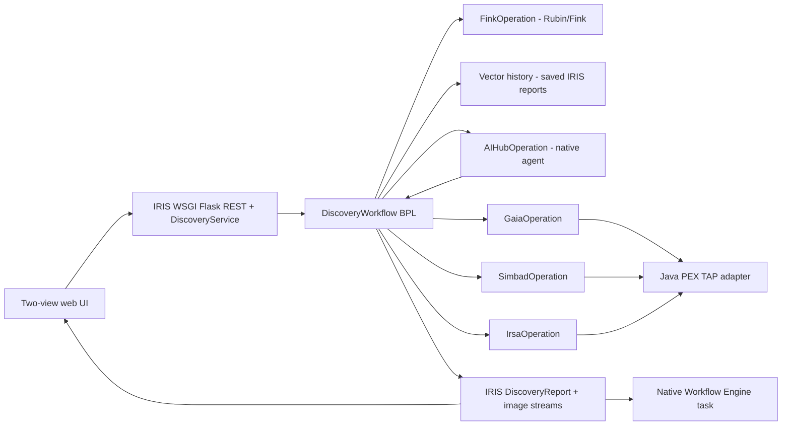

# Gaia Discovery AI — Component Models

**Status:** architecture and interface contracts, not compiled source. **Target:** authorized IRIS AI Hub EAP build 154; verify methods against installed classes. **Language:** English throughout. **Policy:** Python First, minimum native ObjectScript, Java only for the Java PEX custom TAP outbound adapter. **UI is the final implementation gate.**

## System boundary

**Ownership rule:** The AI Hub proposes one next scientific test; the BPL authorizes and routes it; Python normalizes evidence; the Java adapter performs bounded HTTP transport only. The same catalog operation must not also invoke its own LLM or workflow loop.

## Component specifications

| # | Model | Implemented in | Exact responsibility | Primary contracts |
|---|---|---|---|---|
| 01 | [Request and Fink ingestion](components/01_INGESTION.md) | REST/Service/Fink BO | Obtain *actual* Fink observation and images | [FINK](../contracts/FINK.md) |
| 02 | [Production and adaptive BPL](components/02_DISCOVERY_BPL.md) | native IRIS BPL | Choose authorized branch; track evidence/session | [Internal messages](../contracts/INTERNAL_MESSAGES.md) |
| 03 | [Native AI Hub agent](components/03_AI_HUB.md) | `%AI.Agent` + thin BO | Scientific hypothesis and proposed next test | [Decision schema](../contracts/AI_HUB_DECISION.schema.json) |
| 04 | [Catalog connectors and Java PEX](components/04_CATALOGS_PEX.md) | three BOs + one adapter | Independent TAP catalog requests | [GAIA](../contracts/GAIA.md), [SIMBAD](../contracts/SIMBAD.md), [IRSA](../contracts/IRSA.md), [PEX](../contracts/JAVA_PEX_TAP_ADAPTER.md) |
| 05 | [Scientific matching](components/05_SCIENTIFIC_NORMALIZATION.md) | Embedded Python | Validate and compare sky positions/properties | [Crossmatch](../contracts/CROSSMATCH.md) |
| 06 | [Past investigations/Vector Search](components/06_VECTOR_HISTORY.md) | Embedded Python + IRIS SQL | Retrieve analogous case reports | [VECTOR_HISTORY](../contracts/VECTOR_HISTORY.md), [OpenAI](../contracts/OPENAI_EMBEDDINGS.md) |
| 07 | [Report + minimal native reviewer Workflow](components/07_REPORT_REVIEW.md) | Existing BPL, IRIS `%Persistent`, native `EnsLib.Workflow.Operation`/Role/Inbox | Persist-first, one native task type, same-BPL `<sync>` update | [Internal messages](../contracts/INTERNAL_MESSAGES.md) |
| 08 | [WSGI REST and final web UI](components/08_REST_UI.md) | native IRIS WSGI + Flask + Embedded Python + HTML/CSS/JS | Display authentic saved evidence | [UI_SPEC](UI_SPEC.md) |
| 09 | [Docker, ZPM and proof](components/09_DEPLOYMENT.md) | deployment scripts/config | Reproducible installation and bonus evidence | [Bonus plan](../contest/BONUS_IMPLEMENTATION_PLAN.md) |

## Endpoint directory

- [API_ENDPOINT_INDEX.md](../contracts/API_ENDPOINT_INDEX.md) — exact URLs, HTTP verbs, payloads, response fields, and scientific questions.
- [API_CONTRACT_EXAMPLES.md](../contracts/API_CONTRACT_EXAMPLES.md) — runnable *request shapes* plus normalized internal results, clearly marked unexecuted.
- [external_endpoints.json](../contracts/external_endpoints.json) — machine-readable manifest for agents/tests.
- [FINK](../contracts/FINK.md), [GAIA](../contracts/GAIA.md), [SIMBAD](../contracts/SIMBAD.md), [IRSA](../contracts/IRSA.md) — upstream providers' documented endpoints.
- [Internal message contract](../contracts/INTERNAL_MESSAGES.md), [AI decision schema](../contracts/AI_HUB_DECISION.schema.json) — application-specific contracts, **not** external API claims.

## Implementation order and gates

1. Verify build 154 native SDK and public API schema; verify Java gateway/proxy; run `scripts/verify_contracts.py`.
2. Implement ingest + native BPL + one AI Hub decision + one live catalog request. Prove actual IRIS Message Trace and Java adapter call.
3. Add the two remaining catalog paths, Python science calculations, report persistence, Vector Search, Workflow task and ZPM packaging.
4. **Only then** implement the two-view UI from existing REST/report contracts; capture real screenshots.

## Scientific integrity and validation status

- Coordinates and detection IDs come from the Fink alert, not a visually guessed object in an arbitrary image. A PNG cutout may contain several astronomical sources; automatic identification of every pixel object is **not** part of this MVP.
- Spatial matches are candidate counterparts, not proof of identity or discovery. Historical/vector similarity is not a physical crossmatch.
- API HTTP methods, parameters and selected fields were checked against linked official documentation. **End-to-end HTTP execution was not achieved here** due to DNS/network restrictions; SDK signatures, Production build, Java PEX registration and report/vector SQL remain runtime validation gates.

**Exact source class inventory:** [CLASS_MAP.md](../implementation/CLASS_MAP.md). Do not add classes for logical message variants or the native Workflow task.
