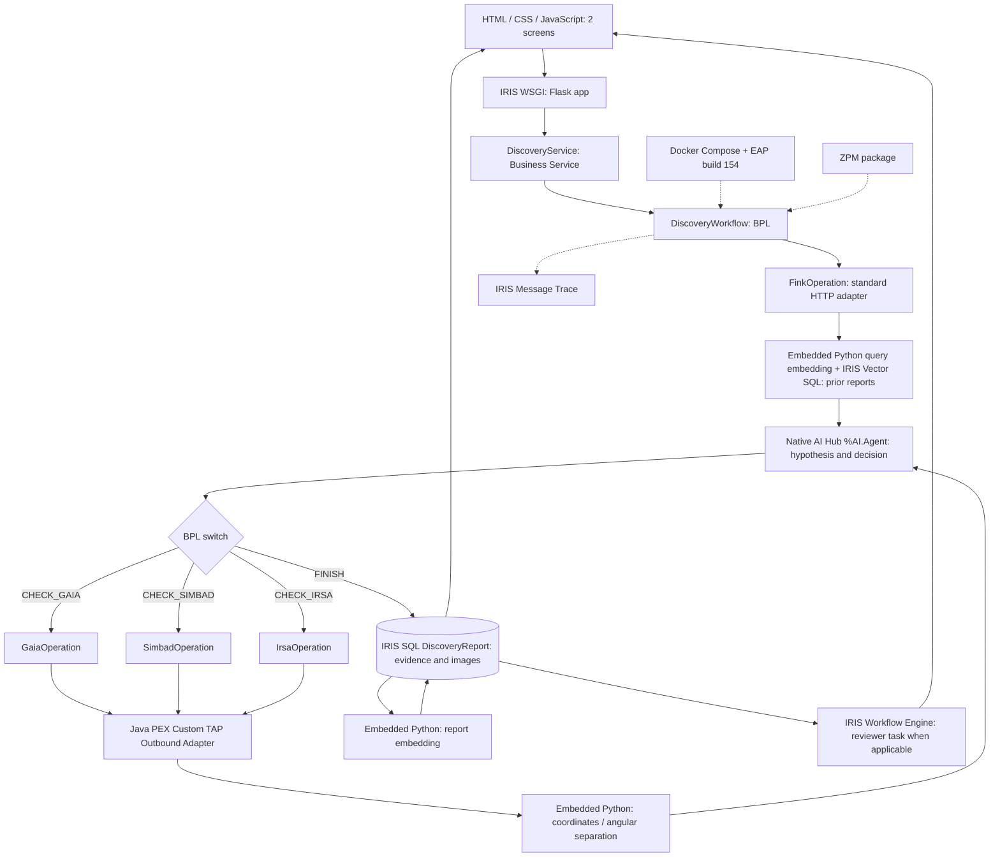

# Gaia Discovery AI — Technology Map (Complete Hypothesis-Driven Workflow)

**Target:** InterSystems IRIS AI Hub EAP build 154. **Status:** design and contract references, not a claim of deployed functionality.  
**Principle:** Python First: in-process Embedded Python owns domain and data handling; ObjectScript only native IRIS declarations/glue; Java only a shared TAP HTTP PEX adapter. One Production, one BPL, one AI Hub agent. See [complete workflow](WORKFLOW.md).

## Python-first implementation policy

Follow the canonical [Python First policy](../../SPEC.md): Embedded Python implements application/data behavior; ObjectScript supplies necessary IRIS-native glue; Java is restricted to the one PEX custom TAP adapter. Verify build-154 compatibility.

**Authority:** This document details the root [SPEC.md](../../SPEC.md). The [class map](../implementation/CLASS_MAP.md) defines the only target implementation class inventory.

## 1. Architecture and execution points



## 2. Full technology-to-feature map

| Technology | Product requirement it solves | Concrete usage / location | Runtime proof | Bonus |
|---|---|---|---|---|
| **InterSystems IRIS Interoperability** | Reliable orchestration and audit of external astronomy observations | One Production, `DiscoveryService`, five Business Operations, `DiscoveryWorkflow` | Production message session and Visual Trace | Core requirement |
| **BPL** | Change scientific investigations dynamically | `<call>` AI Hub, `<switch>` on validated `next_action`, bounded loop | Two alerts with different branches; unused catalog BO not called | Core requirement (not Workflow Engine bonus) |
| **Native IRIS AI Hub** | Form, compare and revise hypotheses; decide next scientifically useful check | `%AI.Agent` and `%AI.Provider` accessed through `AIHubOperation` | Decision payload, scientific question and hypothesis revision correlated with BPL messages | Core contest requirement |
| **Fink REST / Rubin LSST** | Real astronomical alert, coordinates, photometry and images | `FinkOperation`: standard IRIS HTTP adapter + Embedded Python parsing, validation, and stream preparation | Stored Science/Template/Difference images and real IDs | None |
| **Gaia DR3 TAP** | Evaluate plausible stellar source and astrometry | `GaiaOperation`: Embedded Python ADQL generation, CSV parsing and catalog mapping; Java PEX for transport | Gaia response with angular separations | None |
| **SIMBAD TAP** | Known source/galaxy and object type context | `SimbadOperation`: Embedded Python ADQL generation, CSV parsing and catalog mapping; Java PEX for transport | SIMBAD IDs, `otype` and distance | None |
| **NASA IRSA AllWISE TAP** | Infrared context when it can change a hypothesis | `IrsaOperation`: Embedded Python ADQL generation, CSV parsing and catalog mapping; Java PEX for transport | AllWISE W1/W2 and quality fields | None |
| **Java PEX** | Implement a production-native external-language adapter | `com.gaia.discovery.pex.TapOutboundAdapter` extends Java `OutboundAdapter`; registered IRIS proxy | Java gateway/PEX execution on live TAP requests | **3** |
| **Custom Outbound Adapter** | Reuse controlled TAP/ADQL HTTP transport across catalog operations | Same Java PEX adapter *implementation* attached to Gaia/SIMBAD/IRSA native BOs | One custom adapter class registered and actually used | **2** |
| **Embedded Python** | Default implementation language for application logic: HTTP payloads, TAP ADQL, CSV/JSON parsing, scientific matching, context preparation, report CRUD and embeddings | In-process methods in existing BOs, REST handlers, `Gaia.Science.AngularSeparation` and `Gaia.Science.ReportEmbedding` | Actual in-IRIS Python method calls and persisted results | **3** |
| **IRIS Vector Search** | Reuse semantically similar previous investigations | `DiscoveryReport.SearchEmbedding VECTOR(FLOAT,1536)` and top-3 `VECTOR_COSINE` SQL | A new alert retrieves actual prior report IDs and conclusions | **2** |
| **IRIS Workflow Engine** | Minimal human validation of `REVIEW_CANDIDATE`, **+2 potential points** | **Existing BPL** async `<call>` native `EnsLib.Workflow.TaskRequest` → native `EnsLib.Workflow.Operation` named `AstronomyReviewer` (`AutoCreateRole=1` + assigned user) → native Inbox; same BPL `<sync>` receives `TaskResponse.%Action` | Reviewer completes real task; `ReviewStatus` changes in existing report; REST 202 is not held | **2** |
| **IRIS SQL / `%Persistent`** | Retain complete evidence and reports | One native `Gaia.Data.DiscoveryReport` schema; report reads/writes and vector queries in Embedded Python | Reload an investigation with all sources and images | None |
| **IRIS WSGI + Flask REST** | Start investigation and read results | `backend/app.py`: Flask callable hosted by IRIS native WSGI; in-process Embedded Python API/SQL; no `%CSP.REST` class | `POST /api/discoveries/run`, run-status GET, and saved-report GET routes | None |
| **HTML / CSS / JavaScript** | Final presentation after validated backend | Discovery Feed: previous reports with saved Science thumbnails; Investigation Report: 3 authentic cutouts, AI hypotheses/conclusions, catalog source statuses, related reports, IRIS session reference; native Workflow Inbox for review | Both views read only actual persisted IRIS data | None |
| **Docker Compose** | Reproducible EAP runtime | One authorized IRIS EAP 154 image; configured Java gateway in existing deployment | Clean container start and live Production | **2** |
| **ZPM** | Install repeatable application packages | Published module with classes/assets/JAR and tested PEX registration steps | `zpm "install gaia-discovery-ai"` succeeds in a compatible environment | **2** |
| **OpenAI API** | Model reasoning and text embeddings | `%AI.Provider` for AI Hub; existing `OPENAI_API_KEY` for `text-embedding-3-small` | Agent decision + stored 1536-float vector | None |

**Technology bonus target:** 3 + 2 + 3 + 2 + 2 + 2 + 2 = **16 potential points**, conditional on working implementation and contest evaluation. Community Opportunity Idea remains optional and is not a product requirement.

### Important component boundaries

- **PEX and Custom Adapter** share **one Java adapter implementation**, but each native catalog BO uses its configured adapter instance/proxy. Java PEX is distinct from Embedded Python; do not create a Python PEX layer just to claim another bonus.
- **Vector Search** compares *past text reports*, not objects by RA/Dec. Physical association uses coordinates, epoch, uncertainty and photometric metadata. Similarity is not scientific confidence.
- **Workflow Engine** uses the **same BPL** for its native asynchronous `<call>` and `<sync>`; Workflow Engine is the native task/role distribution mechanism, not a second workflow coordinator. One `EnsLib.Workflow.Operation`, one matching Workflow Role, one task type and the built-in Inbox. No custom reviewer service.
- **AI Hub** proposes questions, hypotheses, next action and preliminary assessment; validated BPL branches and deterministic code execute HTTP, SQL, calculations and persistence.
- **Rubin images** are Fink-provided cutouts of a detected alert; identifying **all** objects in the field would need an additional plate-solving/image-astrometry scope not present in the MVP. The AI Hub is not claimed to interpret image pixels directly.

## 3. External API and cross-catalog map

| System | Used HTTP endpoint(s) | Join / evidence fields | Who calls it |
|---|---|---|---|
| Fink | `GET /api/v1/tags`; `POST /api/v1/tags`; `POST /api/v1/sources`; `POST /api/v1/cutouts`; `POST /api/v1/schema` for contract tests | `diaObjectId`, `diaSourceId`, RA/Dec, MJD TAI, flux/error, PNGs | `FinkOperation` |
| ESA Gaia | `POST https://gea.esac.esa.int/tap-server/tap/sync` | `source_id`, RA/Dec, `pmra`, `pmdec`, `parallax`, `phot_g_mean_mag`, `ruwe` | `GaiaOperation` via Java adapter |
| SIMBAD | `POST https://simbad.cds.unistra.fr/simbad/sim-tap/sync` | `main_id`, RA/Dec, `otype` | `SimbadOperation` via Java adapter |
| NASA IRSA | `POST https://irsa.ipac.caltech.edu/TAP/sync` | `designation`, RA/Dec, `w1mpro`, `w2mpro`, `ph_qual` | `IrsaOperation` via Java adapter |
| OpenAI embeddings | `POST https://api.openai.com/v1/embeddings` | `text-embedding-3-small` output vector, 1536 floats | Embedded Python helper |

For TAP, use form-encoded `REQUEST=doQuery`, `LANG=ADQL`, `FORMAT=csv` and validated `QUERY`. Fink public REST does not need credentials; OpenAI requires the configured key. Verify field names in Fink `/api/v1/schema` and TAP catalog schemas at runtime. A valid zero-row search is `EMPTY`; a timeout, HTTP error, or invalid response is `ERROR`.

## 4. Runtime file map

```text
# Planned runtime implementation (not yet present in this specification ZIP):
src/iris/Gaia/                  # exact class inventory in docs/implementation/CLASS_MAP.md
  Data/DiscoveryReport.cls
  Interop/DiscoveryService.cls
  Interop/DiscoveryWorkflow.cls
  Interop/Messages/DiscoveryRequest.cls
  Interop/Messages/DiscoveryResponse.cls
  Interop/Operations/FinkOperation.cls
  Interop/Operations/AIHubOperation.cls
  Interop/Operations/GaiaOperation.cls
  Interop/Operations/SimbadOperation.cls
  Interop/Operations/IrsaOperation.cls
  Science/AngularSeparation.cls
  Science/ReportEmbedding.cls
java-pex/src/main/java/com/gaia/discovery/pex/TapOutboundAdapter.java
backend/app.py  # Flask IRIS WSGI application; implement REST before UI
web/index.html
web/app.js
web/style.css
compose.yaml
module.xml
```

A native Workflow Engine role/inbox/operation is configured in the same Production. This list contains **intended implementation artifacts**; no class compilation or external API request is claimed as tested.

**Build-order invariant:** HTML/CSS/JavaScript is the **last product feature**. First prove the Production, reports, REST responses, PEX/Adapter, Embedded Python, Vector Search and native reviewer task. Then implement only the two UI views specified in [`UI_SPEC.md`](UI_SPEC.md); finish ZPM packaging and demo screenshots afterward.

## 5. UI and operational proof

| UI view | Data source | What judges can verify |
|---|---|---|
| Discovery Feed | IRIS-hosted Flask WSGI → `DiscoveryReport` | Previous reports newest first; real Science thumbnails, AI assessment, observation date, reviewer status, run initiation and optional history search |
| Investigation Report | IRIS-hosted Flask WSGI → `DiscoveryReport` | Three Fink cutouts, AI scientific report with uncertainties, catalog sources actually consulted vs NOT_REQUESTED, related report links, reviewer status, Interoperability session ID |
| Native Workflow Inbox | IRIS Workflow Engine | A human reviewer accepts/rejects a real task; report updates without new UI page |
| IRIS Visual Trace | Native Production | Fink, AI Hub, selected catalog BOs and report correlation; adapter's internal calls need correlated Java logs |

## 6. Deployment gates and references

1. First demonstrate a real Fink alert and AI Hub decisions changing the BPL execution.
2. Register Java PEX adapter and prove Gaia, SIMBAD and IRSA live TAP calls using that same implementation.
3. Prove in-process Python sky separation and a real IRIS `VECTOR_COSINE` search over saved report embeddings.
4. Prove a native Workflow Engine reviewer task and status change.
5. Publish ZPM and verify a clean installation with the EAP Docker build 154.

Reference documents: [workflow](WORKFLOW.md), [SPEC](../../SPEC.md), [implementation guide](../implementation/IMPLEMENTATION_GUIDE.md), [UI Specification](UI_SPEC.md), [Fink](../contracts/FINK.md), [Gaia](../contracts/GAIA.md), [SIMBAD](../contracts/SIMBAD.md), [IRSA](../contracts/IRSA.md), [Java PEX adapter](../contracts/JAVA_PEX_TAP_ADAPTER.md), [Vector history](../contracts/VECTOR_HISTORY.md), [AI Hub decision schema](../contracts/AI_HUB_DECISION.schema.json).

Official sources:
- https://community.intersystems.com/post/intersystems-programming-contest-ai-agents-interoperability-workflows
- https://community.intersystems.com/post/technology-bonuses-intersystems-programming-contest-ai-agents-interoperability-workflows
- https://irisdocs.intersystems.com/irislatest/csp/docbook/DocBook.UI.Page.cls?KEY=EPEX_outbound
- https://irisdocs.intersystems.com/irislatest/csp/docbook/DocBook.UI.Page.cls?KEY=EGWF_dev
- https://irisdocs.intersystems.com/irislatest/csp/docbook/DocBook.UI.Page.cls?KEY=GSQL_vecsearch
- https://doc.lsst.fink-broker.org/services/summary/

## Component model and API contract links

- [COMPONENT_MODELS.md](COMPONENT_MODELS.md) details exact component responsibility and handoffs.
- [API_ENDPOINT_INDEX.md](../contracts/API_ENDPOINT_INDEX.md) maps every external endpoint to request and result fields.
- [external_endpoints.json](../contracts/external_endpoints.json) is the agent-readable endpoint manifest.
- [INTERNAL_MESSAGES.md](../contracts/INTERNAL_MESSAGES.md) gives IRIS request/response logical shapes.
- [CROSSMATCH.md](../contracts/CROSSMATCH.md) defines what scientific information is and is not comparable.

**Canonical class ownership:** [CLASS_MAP.md](../implementation/CLASS_MAP.md) and [CLASS_CONTRACTS.md](../implementation/CLASS_CONTRACTS.md). `Gaia.AI.DiscoveryAgent` extends native `%AI.Agent` and owns its existing SDK configuration; `AIHubOperation` composes it within the Production. See [migration model](../implementation/DISCOVERY_AGENT_MIGRATION.md).
