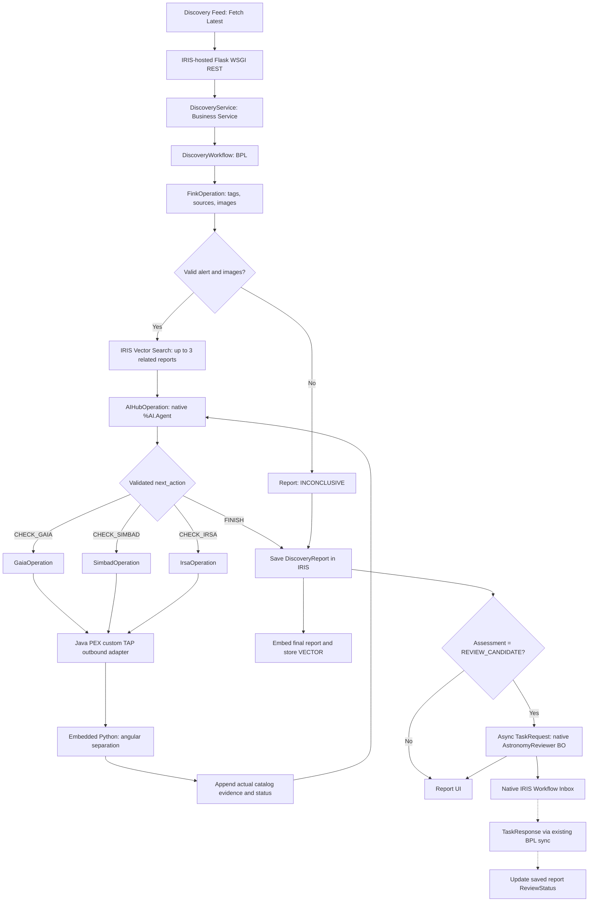

# Gaia Discovery AI — Complete Interoperability Workflow

**Target:** InterSystems IRIS AI Hub EAP build 154. **Status:** implementation design; external API and installed-SDK runtime tests are still required.  
**Build sequence:** UI is implemented **after** the Production, report REST API and bonus feature acceptance tests. See [`UI_SPEC.md`](UI_SPEC.md).  
**Design:** Python First. In-process Embedded Python implements scientific and application behavior; native IRIS declarations/BPL/AI Hub SDK retain minimal ObjectScript; a small Java PEX adapter is dedicated to TAP HTTP. One Production, one BPL, one native agent, five BOs, one report, two views. The native Workflow Engine adds one human-review task type.

## Python-first implementation policy

Follow the canonical [Python First policy](../../SPEC.md): Embedded Python implements application/data behavior; ObjectScript supplies necessary IRIS-native glue; Java is restricted to the one PEX custom TAP adapter. Verify build-154 compatibility.

**Authority:** This document details the root [SPEC.md](../../SPEC.md). The [class map](../implementation/CLASS_MAP.md) defines the only target implementation class inventory.

## 1. End-to-end execution



**Execution invariant:** The AI Hub chooses *what to investigate and why*; the BPL chooses only a permitted executable branch. It is valid to finish without querying any catalog. An unperformed catalog is not an error. A call to the same catalog twice in one investigation is prohibited.

**UI output:** The final two-view frontend lists **previous reports** with Science thumbnails and opens a detailed report with all three Fink images, the AI-generated scientific assessment and hypothesis revisions, catalog sources **consulted / not requested**, related historical investigations and the IRIS session ID. It renders persisted records only, not live external queries or invented images.

## 2. Detailed lifecycle

| Step | Production component | Input | Action | Output / persisted evidence |
|---|---|---|---|---|
| 1 | `backend/app.py` Flask WSGI → `DiscoveryService` | Fink tag, `1 <= count <= 20` | Start one run; return `runId` | Run identifier; BPL session |
| 2 | `DiscoveryWorkflow` → `FinkOperation` | Tag | `POST /api/v1/tags`, deduplicate `diaObjectId` values | Real source IDs |
| 3 | `FinkOperation` | `diaObjectId` | `POST /api/v1/sources` | `diaSourceId`, RA/Dec, observation time, PSF flux/error |
| 4 | `FinkOperation` | Selected `diaSourceId` | `POST /api/v1/cutouts` for Science, Template, Difference | Three PNG binary streams; stored as stream references |
| 5 | BPL validation | Alert and image metadata | Validate required position, time, detection and image bytes | Valid observation or `INCONCLUSIVE` with reason |
| 6 | Embedded Python + IRIS Vector SQL | Deterministic alert summary | Generate a short text embedding; retrieve at most 3 earlier report embeddings | `historicalAnalogies`; empty if unavailable |
| 7 | `AIHubOperation` | Observation + analogies + already performed checks | Native agent proposes hypothesis, alternative, specific scientific question and `next_action` | JSON decision + reason, correlated with run |
| 8 | `DiscoveryWorkflow` | Validated action | `switch` to one catalog Operation, or `FINISH` | Actual BPL branch taken |
| 9 | Selected catalog Operation + Java PEX TAP adapter | Alert RA/Dec, bounded radius | Embedded Python builds validated ADQL; Java PEX POSTs TAP; Embedded Python parses bounded CSV | Catalog rows, `OK`/`EMPTY`/`ERROR`, request provenance |
| 10 | Embedded Python | Event and catalog row coordinates | Calculate angular separation; preserve uncertainties and source IDs | Matched *candidates* with separations, not declared identities |
| 11 | BPL → `AIHubOperation` | Updated evidence set | Re-evaluate hypothesis and either select a different useful test or finish | Hypothesis history, further route or final assessment |
| 12 | `DiscoveryReport` | Images, evidence, decisions, final assessment | Save in IRIS SQL / persistent streams | Full report, `InteropSessionId`, creation date |
| 13 | Embedded Python + IRIS Vector SQL | Final report's `SearchText` | Generate `text-embedding-3-small` vector and update existing report | `VECTOR(FLOAT,1536)` for later similarity search |
| 14 | Existing BPL → native Workflow BO | Saved `REVIEW_CANDIDATE` report ID | Set `PENDING`, async `<call>` native `TaskRequest` to `AstronomyReviewer`, actions `ACCEPT,REJECT` | Native Inbox task; on dispatch error set `TASK_ERROR` |
| 15 | Same BPL `<sync>` → persisted report | Native `TaskResponse.%Action` | Await human completion separately from the browser request; update **same** report by ID | `ACCEPTED_FOR_REVIEW` or `REJECTED` (not scientific discovery) |
| 16 | IRIS-hosted Flask WSGI + web UI | Report ID | Read saved record and three image streams | Feed / Investigation Report, evidence, trace reference |

**Per-alert scope:** The run may process 1–20 Fink objects (default 5), sequentially; each object has its own evidence, report and bounded AI decisions. A failed catalog query is `ERROR`, not a scientifically meaningful `EMPTY` result.

### Nonblocking report vs. native BPL task wait

The Flask WSGI REST handler (at the IRIS application mount `/gaia`) accepts work and returns `202 {runId}` **before** the Production finishes. When a candidate is saved, the report immediately shows `PENDING` and the run may report scientific `COMPLETED` after all scientific outputs have been persisted. The Production's BPL waits on `<sync>` for human replies **independently** of the HTTP request. Do not equate "run's scientific work completed" with "all reviewers have acted". For multiple alerts, save and dispatch all candidates before the BPL's review synchronization; correlate native responses by the original report IDs in BPL context. A task-dispatch error is `TASK_ERROR`. No background poller or second process is needed.

## 3. AI Hub decision and loop

The native `%AI.Agent` receives a bounded, factual context containing: observation metadata, Fink tag, previously searched catalogs with status, at most three earlier semantically similar reports **labeled as historical analogies**, current hypothesis/alternative, latest independent evidence, and remaining query budget. The model does not receive network access, raw SQL permission, or arbitrary code execution.

The structured output must conform to `contracts/AI_HUB_DECISION.schema.json`:

```json
{
  "hypothesis": "A variable stellar source may explain the alert",
  "alternative": "An extragalactic transient remains plausible",
  "next_action": "CHECK_SIMBAD",
  "question": "Is there a cataloged object near the observed coordinates?",
  "reason": "A known object type could help distinguish the hypotheses",
  "assessment": null
}
```

On `FINISH`, `question` must be empty and `assessment` must be one of `CATALOG_CONTEXT_FOUND`, `REVIEW_CANDIDATE`, `INCONCLUSIVE`. The BPL applies **deterministic validation** outside the LLM. Max three catalog operations, one per source, at most four agent decisions. Invalid/duplicate/over-budget actions result in a safely saved `INCONCLUSIVE` report, not a new arbitrary branch. History may inform the hypothesis but is never treated as an independently observed counterpart.

## 4. External API contracts and actual cross-catalog joins

| Source | Method / endpoint | Input to query | Response used | Why the result matters |
|---|---|---|---|---|
| Fink | `GET https://api.lsst.fink-portal.org/api/v1/tags` | No parameters | Supported tag names | Select real public alert categories |
| Fink | `POST https://api.lsst.fink-portal.org/api/v1/tags` | `tag`, `n`, `columns` | `r:diaObjectId` | Discover a recent observation |
| Fink | `POST https://api.lsst.fink-portal.org/api/v1/sources` | `diaObjectId`, `columns` | `r:diaSourceId`, `r:ra`, `r:dec`, `r:midpointMjdTai`, `r:psfFlux`, `r:psfFluxErr` | Locate the alert and select a specific detection |
| Fink | `POST https://api.lsst.fink-portal.org/api/v1/cutouts` | `diaSourceId`, `kind = Science/Template/Difference` | Three PNG images | Display direct observational evidence |
| ESA Gaia DR3 | `POST https://gea.esac.esa.int/tap-server/tap/sync` | ADQL cone around Fink RA/Dec | `source_id`, `ra`, `dec`, `pmra`, `pmdec`, `parallax`, `phot_g_mean_mag`, `ruwe` | Investigate a plausible stellar counterpart |
| CDS SIMBAD | `POST https://simbad.cds.unistra.fr/simbad/sim-tap/sync` | ADQL cone around Fink RA/Dec | `main_id`, `otype`, `ra`, `dec` | Identify cataloged objects and types in field |
| NASA IRSA AllWISE | `POST https://irsa.ipac.caltech.edu/TAP/sync` | ADQL cone around Fink RA/Dec | `designation`, `ra`, `dec`, `w1mpro`, `w2mpro`, `ph_qual` | Study infrared sources and their data quality |

For all TAP requests use form-encoded `REQUEST=doQuery`, `LANG=ADQL`, `FORMAT=csv`, and bounded `QUERY`. Each catalog Operation owns *specific ADQL construction, CSV parsing, field validation and result mapping in Embedded Python*; Java PEX owns only common HTTP transport, endpoint allowlist, TLS, timeouts and response-size limits. The Fink Operation uses the standard IRIS HTTP adapter and does not use Java PEX.

**Correlation keys:** Fink `diaObjectId` groups alerts; `diaSourceId` identifies a particular detection and image; external Gaia `source_id`, SIMBAD `main_id`, and AllWISE `designation` are never equated. Spatial matching uses RA/Dec plus angular distance, with observation epoch and proper motion considered where relevant. Neighboring sources or possible host galaxies are not necessarily the detected transient. Vector similarity over previous reports is **not** a physical sky match or a calibrated probability. The AI Hub must never label a new discovery as scientifically confirmed.

Documentation: [Fink](../contracts/FINK.md), [Gaia](../contracts/GAIA.md), [SIMBAD](../contracts/SIMBAD.md), [IRSA](../contracts/IRSA.md), [Java PEX Adapter](../contracts/JAVA_PEX_TAP_ADAPTER.md), [Vector history](../contracts/VECTOR_HISTORY.md).

## 5. Report, review and UI

A single `Gaia.Data.DiscoveryReport` `%Persistent` record stores `RunId`, Fink identifiers, coordinates/time, classification/assessment, current and alternative hypotheses, action/evidence JSON, external query provenance, Science/Template/Difference streams, Interoperability session ID, `SearchText`, `SearchEmbedding`, review status and creation time.

- **Discovery Feed:** selected tag + Fetch Latest, list of saved investigations, statuses, optional semantic search over prior conclusions.
- **Investigation Report:** three **real** Fink cutouts, initial and final hypotheses, chronological decisions, performed catalog calls and angular separations, related past reports, final assessment, human review status and a link/reference to the native IRIS Visual Trace.
- **Workflow Engine:** the existing `DiscoveryWorkflow` BPL performs an asynchronous `<call>` to **one native** `EnsLib.Workflow.Operation` named `AstronomyReviewer` with `AutoCreateRole=1`, using a native `EnsLib.Workflow.TaskRequest` (`%Actions="ACCEPT,REJECT"`). Assign an IRIS Workflow user to that native role. Use BPL `<sync>` with native `EnsLib.Workflow.TaskResponse.%Action` to update the **same pre-saved report**. Browser `POST /run` has already returned `202`; waiting in BPL does not block it. The reviewer uses the built-in Inbox. **No second BPL, callback service, task table, custom Workflow class, or review UI.** See [Component 07](components/07_REPORT_REVIEW.md).

The UI never directly calls astronomy APIs or executes the AI agent. All listed `/api/...` paths are relative to the WSGI application mount `/gaia` (external `/gaia/api/...`); use relative paths in the browser. Its API routes are `POST /api/discoveries/run`, `GET /api/discoveries/runs/{runId}`, `GET /api/discoveries`, `GET /api/discoveries/{id}`, `GET /api/discoveries/{id}/images/{kind}`.

## 6. Runtime proof and failure rules

1. Show two **real** alerts following different `AIHubOperation` decisions and different BPL Message Traces. Not all three catalogs must be queried.
2. Show a real TAP response crossing the Java PEX custom adapter into a native catalog Business Operation; use actual adapter/gateway logs to prove Java execution. Adapter methods are not automatically separate BPL trace messages.
3. Show Embedded Python computing arcsecond separations and producing vectors; IRIS SQL must actually execute `VECTOR_COSINE` over saved report vectors.
4. Show `REVIEW_CANDIDATE` creating and completing one native Workflow Engine task; the same report status must update.
5. Show images stored in IRIS and loaded via the local REST API, not demonstration placeholders.
6. Empty TAP results, TAP timeouts, missing Fink images, invalid LLM outputs, and embedding failures must be distinguished. Embedding outages do **not** prevent report persistence.
7. Verify and compile exact `%AI.*` SDK calls and Java PEX gateway/registration in installed EAP build 154. No proof is claimed before runtime tests.
8. Run with the authorized EAP Docker image; install and **publish** a reproducible ZPM module. No extra Java service container, database or UI page is required.

### References

- https://community.intersystems.com/post/intersystems-programming-contest-ai-agents-interoperability-workflows
- https://community.intersystems.com/post/technology-bonuses-intersystems-programming-contest-ai-agents-interoperability-workflows
- https://irisdocs.intersystems.com/irislatest/csp/docbook/DocBook.UI.Page.cls?KEY=EPEX_outbound
- https://irisdocs.intersystems.com/irislatest/csp/docbook/DocBook.UI.Page.cls?KEY=EGWF_dev
- https://doc.lsst.fink-broker.org/services/api/definitions/
- https://doc.lsst.fink-broker.org/services/summary/

## Component-by-component execution contract

The same end-to-end flow is decomposed into nine implementation models at [COMPONENT_MODELS.md](COMPONENT_MODELS.md). The catalog/API operations follow [API_ENDPOINT_INDEX.md](../contracts/API_ENDPOINT_INDEX.md), [API_CONTRACT_EXAMPLES.md](../contracts/API_CONTRACT_EXAMPLES.md) and [INTERNAL_MESSAGES.md](../contracts/INTERNAL_MESSAGES.md). Each individual scientific API result is processed inside its actual Business Operation (Embedded Python for domain parsing, Java PEX only for TAP transport), returned to BPL and recorded in the report.

**Class contracts and current batch size:** see [CLASS_CONTRACTS.md](../implementation/CLASS_CONTRACTS.md) and [master SPEC](../../SPEC.md); count is configurable 1–20 (default 5), processed sequentially. This limit is independent of 3 catalog queries per alert.
