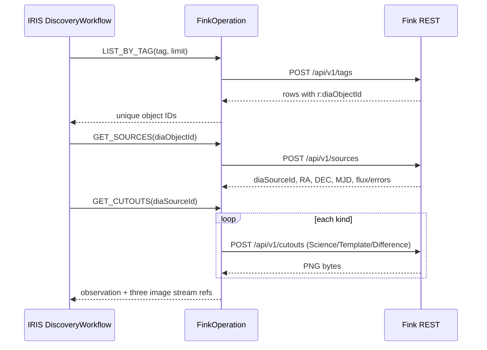

# Component 01 — Fink Observation Ingestion

**Purpose:** obtain a recent, real, publicly accessible Rubin alert and the three cutout images associated with one `diaSourceId`. No direct user image upload in this MVP. **Python-first:** process JSON and image bytes in Embedded Python inside `FinkOperation`.

## Native components

| Name | Responsibility | Boundary |
|---|---|---|
| `backend/app.py` (IRIS-hosted Flask WSGI) | accept application-relative `POST /api/discoveries/run` (`tag`, bounded `count`) | submit asynchronously to `DiscoveryService` using in-process IRIS APIs; do not call astronomy APIs from browser |
| `Gaia.Interop.DiscoveryService` | create correlated `runId`, submit to `DiscoveryWorkflow` | thin native IRIS Business Service |
| `Gaia.Interop.Operations.FinkOperation` | HTTP calls to Fink; parse and validate results | native Business Operation + standard HTTP outbound adapter + Embedded Python |

**Logical methods (design signatures, verify IRIS build):** `select_alerts(tag,limit: 1..20)->list[str]`; `get_sources(diaObjectId)->list[Detection]`; `get_cutouts(diaSourceId)->{science,template,difference}`. These are application method names, not vendor SDK signatures.

## Endpoint chain

**Input:** supported Fink tag from live `GET /api/v1/tags`, limit 1–20, unique `runId`.

**Output (`Observation`):** `diaObjectId` and `diaSourceId` as **decimal strings** (prevent JavaScript >2^53 precision loss); `raDeg`, `decDeg`, `observedMjdTai`, `psfFlux`, `psfFluxErr`, `tag`, `imageRefs` and `finkQueryStatus`. Missing optional photometry becomes `null`; do not fabricate values.

**Validation:** `raDeg in [0,360)`, `decDeg in [-90,90]`, finite numeric position and time; `diaSourceId` belongs to same `diaObjectId` result; cutout PNG signature/content-type checked, binary cap and storage refs enforced. The Fink cutout PNG has no guarantee of comprehensive WCS for every visible star; use its event coordinates.

**Error behavior:** no tag matches -> run `NO_ALERTS` in the bounded run-status global (not a fake DiscoveryReport); partial image retrieval or missing required coordinates -> save `INCONCLUSIVE` observation report where an object exists, no LLM claim of discovery. Deduplicate object IDs per run; small HTTP/time limits.

**Proof:** real `LIST_BY_TAG → GET_SOURCES → GET_CUTOUTS` messages correlated to one run; three PNG URLs from saved IRIS streams; never use illustrative pictures in final UI.

**Contract:** [`contracts/FINK.md`](../../contracts/FINK.md); upstream tag/docs: https://doc.lsst.fink-broker.org/services/api/tagsearch/ , https://doc.lsst.fink-broker.org/services/api/imagesearch/ .

**Current batch policy:** `count` is 1–20, default 5; the Production investigates selected objects sequentially and does not confuse this with the per-alert maximum of 3 distinct catalog checks.
