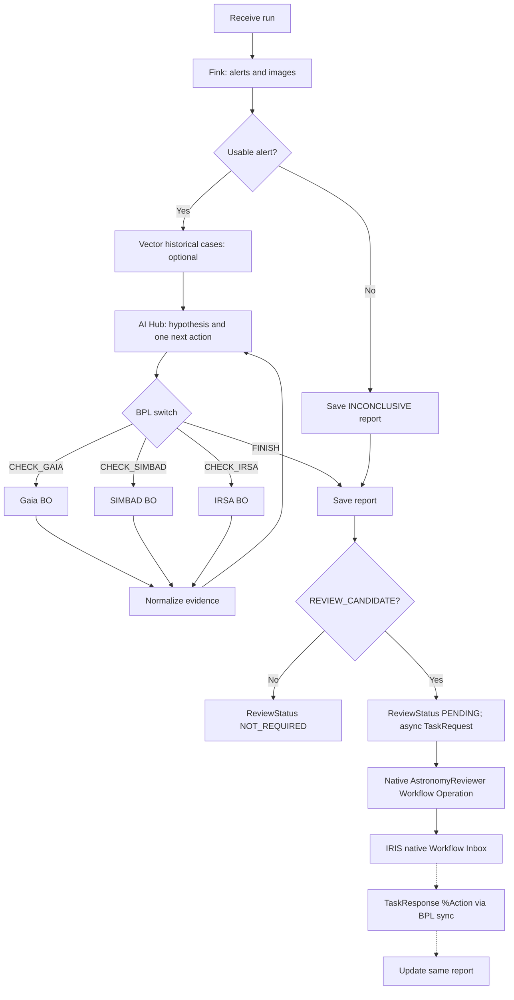

# Component 02 — Single Production + Adaptive BPL

**Purpose:** reuse **one** `Gaia.Interop.DiscoveryWorkflow` BPL for scientific decisions **and** native human review. The BPL validates AI Hub output; the agent does not modify BPL or directly call arbitrary external systems.

## Production hosts

| Host | Type | Responsibility |
|---|---|---|
| `DiscoveryService` | Business Service | Receive a `runId` submitted by REST |
| `DiscoveryWorkflow` | **one** `Ens.BusinessProcess.BPL` | Ingest, route agent decisions, save reports, issue and await native review messages |
| `FinkOperation` | Business Operation | Alert metadata and three real cutouts |
| `AIHubOperation` | Business Operation | Native AI Hub scientific decisions |
| `GaiaOperation`, `SimbadOperation`, `IrsaOperation` | Three Business Operations | Python-built TAP ADQL, one shared Java PEX adapter |
| `AstronomyReviewer` | **native** `EnsLib.Workflow.Operation` | Enqueue one human task per `REVIEW_CANDIDATE` report; associated Workflow Role with identical name |

**Application messages:** use only `Gaia.Interop.Messages.DiscoveryRequest` / `DiscoveryResponse` typed envelopes for application-specific calls; see [internal contracts](../../contracts/INTERNAL_MESSAGES.md). For the Workflow Operation, use native `EnsLib.Workflow.TaskRequest` / `TaskResponse` **without extra subclasses**.

## Execution

**Review does not slow scientific output:** persist all scientific reports, issue async native requests for candidates, then let the **same BPL** perform native `<sync>` when waiting on human responses. Report/run status is available via REST before task completion. The `POST /run` returns `202` immediately; a suspended BPL is not a suspended browser request. Workflow task errors set `TASK_ERROR`, never fabricate review approval. See [Component 07](07_REPORT_REVIEW.md) for the **only authoritative Workflow configuration and task mapping**.

**Bounded execution:** configurable 1–20 alert objects per run (default 5), processed sequentially, maximum three distinct catalog actions and four AI decisions per alert. Any number of the three scientific catalogs may remain `NOT_REQUESTED`. Neither invalid AI output nor an external-service error can create a fictitious scientific match.

**Proof:** actual Message Trace shows a selectable catalog route and an asynchronous `<call>` into native Workflow Operation; reviewer completion returns `EnsLib.Workflow.TaskResponse.%Action` to existing BPL `<sync>` and updates an existing saved report. No second BPL, callback service or reviewer UI.
